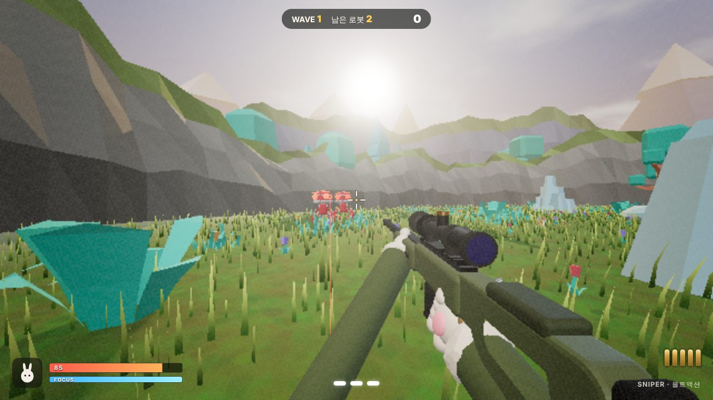

# Sniper Bunny 🐰🎯

토끼 저격수가 슬로모션 속에서 로봇 군단의 머리를 날려버리는 1인칭 웹 FPS (Three.js + TypeScript + Vite).



## 실행

```bash
cd game
npm install
npm run dev
```

브라우저에서 http://127.0.0.1:5188 접속 → "클릭해서 시작".

- `?lowfx` — 저사양 모드 (해상도 50%, MSAA 끔)
- `?hitbox` — 로봇 머리/몸통 판정 구체 표시 (디버그)

## 조작

| 입력 | 동작 |
| --- | --- |
| WASD | 이동 |
| Space | 일반 점프 |
| Shift | 하이 플립 점프 (앞구르기 회전). 지상 1회 + 공중 2회 |
| 우클릭 (홀드) | 스코프 조준 + 슬로모션 (포커스 게이지 소모) |
| 좌클릭 | 스나이퍼 발사 (볼트액션) |
| F 꾹 누르기 → 놓기 | 슬로모션 + 단검 차징/락온 → 놓으면 대상에게 대쉬 후 베기 |
| R | 재장전 (5발) |
| Esc | 일시정지 |

## 규칙

- 헤드샷 = 즉사 (머리가 분리되어 날아감), 몸샷 = 60 데미지 (2발에 사망)
- 단검 대쉬 베기 = 즉사 (상반신 절단, 절단면이 녹은 금속처럼 빛남)
- 공중 헤드샷 +150 보너스, 4초 안에 연속 킬 시 콤보 배율
- 포커스(슬로모션 게이지)는 헤드샷/단검 킬로 회복
- 돌격 로봇(주황): 달려와서 펀치 / 포격 로봇(빨강): 빨간 조준선 후 플라즈마 탄 (피할 수 있음)

## 구조

```
game/src/
  core/        입력(포인터 락), 루프, 렌더러
  game/Game.ts 게임 흐름, 슬로모션/히트스톱/카메라 셰이크, 사격·단검 판정, 점수
  player/      FPS 이동, 점프, 플립 점프, 대쉬
  view/        절차적 1인칭 모델(토끼 앞발, 스나이퍼, 단검) + 뷰모델 애니메이션
  enemies/     로봇 AI, 웨이브, 플라즈마 탄, 헤드샷/절단 연출
  world/       맵(하늘, 잔디 셰이더, 절벽 링, 소품 배치), 충돌
  systems/     VFX(스파크·연기·트레이서), 절차적 사운드, 포스트 프로세싱
  ui/Hud.ts    HUD
```

## 에셋 라이선스

전부 CC0.
- 로봇: RobotExpressive — Tomás Laulhé (Quaternius), three.js 예제 저장소 경유
- 지형 소품: [Kenney](https://kenney.nl) Nature Kit, Space Kit
- 토끼 앞발/스나이퍼/단검/절벽/잔디/사운드: 코드로 직접 생성

## 설치된 Claude Code 스킬 (`.claude/skills`)

- [majidmanzarpour/threejs-game-skills](https://github.com/majidmanzarpour/threejs-game-skills) — 게임플레이/타격감, AAA 그래픽, UI, QA (9개)
- [CloudAI-X/threejs-skills](https://github.com/CloudAI-X/threejs-skills) — 최신 three.js API 레퍼런스 (13개)
- [anthropics/skills](https://github.com/anthropics/skills) `webapp-testing` — Playwright 테스트
- [JuliusBrussee/caveman](https://github.com/JuliusBrussee/caveman) 중 작업용 스킬(lean-build, surgical-patch, verify-and-stop, investigate-first, cavecrew) + `.claude/agents/cavecrew-*` — 토큰 절약용 (말투 스킬은 제외)
